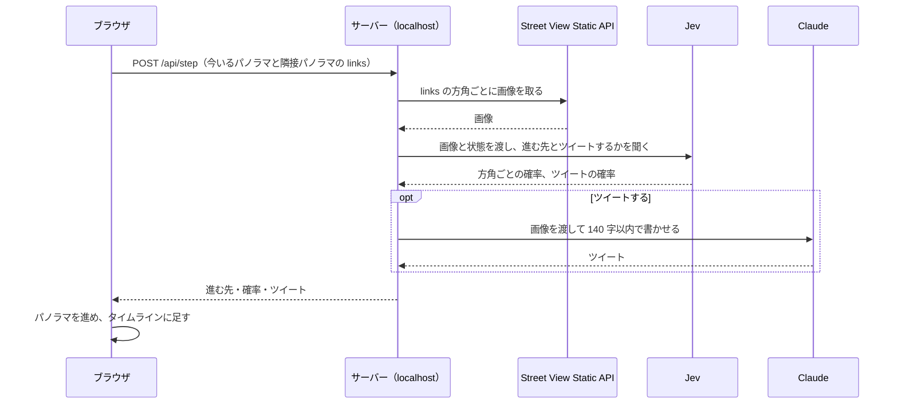

# sampo-agent 設計

AI がストリートビューの中を散歩し、気になった場所でツイートを書く。その様子をブラウザで眺める。

## 前提

- 個人用。アプリは手元（localhost）でだけ動かし、どこにもデプロイしない。
- リポジトリは public にする。API キーなどの秘密情報はコミットしない。
- 出発点は日本の鉄道駅からランダムに選ぶ。
- ツイートはアプリ内のタイムラインに出す。X などには投稿しない。

## 1 歩の流れ

- 隣接パノラマは Maps JavaScript API の `StreetViewService` で取る。Static API と Metadata API は隣へのつながりを返さないので、この役目はブラウザが持つ。
- 1 歩はおよそ 5 秒おき。一時停止と再開をボタンで切り替えられる。

## 出発点

- 国土数値情報の鉄道データ（N02）から駅の名前、路線、座標を抜き出し、JSON にして同梱する。
- 駅をランダムに 1 つ選び、`getPanorama`（半径 50m、屋外）でパノラマを探す。見つからなければ別の駅を引き直す。

## Jev への問い

1 回のリクエストに問いをまとめる。画像は Jev 1.14 の実験機能なので、`TypeSafe-Danger-Zone-Images: true` ヘッダーを付け、`assets` に登録して `state` から参照する。

| 問い | 型 | 内容 |
|---|---|---|
| direction | choice | どの方角へ進むと散歩として面白そうか。候補は links の各方角 |
| tweet | noul | 今いる場所の景色は、思わずツイートしたくなるものか |

`state` には出発した駅の名前、歩いた歩数、最近の曲がり方、通ったパノラマの ID を入れる。同じ場所を回り続けないためのもの。

ツイートが多すぎないように、次の 2 つを両方満たしたときだけ書く。

- tweet の確率がしきい値（最初は 0.7）以上
- 前のツイートから 10 歩以上歩いている

## ツイートを書く

- 進む前の正面の画像と、出発した駅の名前、歩数を Claude に渡す。
- 散歩している本人の一人称で、140 字以内。超えたら 1 回だけ書き直させ、それでも超えたら切り詰める。

## 画面

- 左にストリートビュー（JS API のパノラマ表示）、右にタイムライン。
- Jev の判断（方角ごとの確率、ツイートの確率）を小さく出す。
- タイムラインの 1 件は、本文、時刻、そのときの場所。

## 画像の扱い

Google Maps Platform の規約は、ストリートビューの画像を保存したり後から使ったりすることを制限している。そこで次のようにする。

- 画像はサーバーのメモリ上でだけ使い、ディスクに書かない。
- タイムラインには画像を保存しない。残すのはパノラマ ID と座標で、表示するときに JS API で描き直す。
- 実装の前に規約を読み、Jev と Claude に画像を渡すことに問題がないか確かめる。

## 構成

- サーバーは Go で書く。画面は Vite + Preact の SPA。
  - 開発中は Vite の開発サーバーが `/api` を Go のサーバーへ中継する。
  - ビルドした SPA は Go のサーバーが配る。
- API キーは環境変数でサーバーに渡す。
  - `GOOGLE_MAPS_API_KEY`: ブラウザにも渡る。リファラーを localhost に絞る。
  - `TYPESAFE_API_KEY`、`ANTHROPIC_API_KEY`: サーバーだけが持つ。
- キーの置き場所など手元だけの情報は `docs/local.md` に書き、`.gitignore` でコミットから外す。
- 散歩の記録（タイムラインと歩いた道）はブラウザの localStorage に残す。
- mise のタスク `dev`、`test`、`lint` を置く。

## 費用の見積もり

1 歩で Static API の画像を 2〜4 枚、Jev を 1 回呼ぶ。1 時間散歩すると約 720 歩になる。

- Street View Static API: 約 2,000 枚。無料枠を超えた分が課金される。
- Jev: 画像の分だけ入力トークンが増える。単価は小さいので、実際の使用量を見てから考える。
- Claude: ツイート 1 件につき 1 回。

単価と無料枠は実装の前に Google と TypeSafe の料金表で確かめる。

## 決めていないこと

- Claude を Anthropic API で直接呼ぶか、neta と同じく Bedrock 経由にするか。
- ツイートに使う Claude のモデル。

## 進め方

1. Jev の画像入力を試す。駅前のパノラマ数か所で、方角の選び方とツイートの判定がもっともらしいかを見る。
2. サーバーの `/api/step` と駅データ。
3. 画面。
